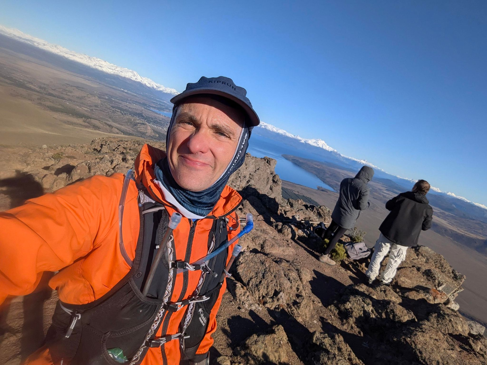

## 📊 Estadísticas Clave
- **Distancia:** 18.29 km
- **Desnivel Positivo:** 1512.0 m 🏔️
- **Tiempo en movimiento:** 199:52
- **Tipo de actividad:** Run

## 🗺️ Mapa y Recorrido


## ⏱️ Vueltas (Laps)
| Lap | Distancia | Tiempo | Ritmo | FC Med |
| :--- | :--- | :--- | :--- | :--- |
| 1 | 1.0 km | 6:35 | 6:35 | 120.0 |
| 2 | 1.0 km | 9:59 | 9:59 | 137.5 |
| 3 | 1.0 km | 12:51 | 12:51 | 156.1 |
| 4 | 1.0 km | 17:04 | 17:04 | 152.8 |
| 5 | 1.0 km | 14:21 | 14:21 | 149.5 |
| 6 | 1.0 km | 23:13 | 23:13 | 144.8 |
| 7 | 1.0 km | 6:15 | 6:15 | 133.5 |
| 8 | 1.0 km | 5:38 | 5:38 | 150.9 |
| 9 | 1.0 km | 5:57 | 5:57 | 151.4 |
| 10 | 1.0 km | 11:57 | 11:57 | 143.4 |
| 11 | 1.0 km | 14:23 | 14:23 | 154.9 |
| 12 | 1.0 km | 16:48 | 16:48 | 162.1 |
| 13 | 1.0 km | 15:11 | 15:11 | 158.9 |
| 14 | 1.0 km | 12:59 | 12:59 | 157.9 |
| 15 | 1.0 km | 5:24 | 5:24 | 141.8 |
| 16 | 1.0 km | 5:57 | 5:57 | 157.5 |
| 17 | 1.0 km | 5:29 | 5:29 | 159.7 |
| 18 | 1.0 km | 5:54 | 5:54 | 156.2 |
| 19 | 0.68 km | 7:39 | 11:20 | 164.3 |

## 📸 Fotos

---
*Generado automáticamente vía API de Strava.*
