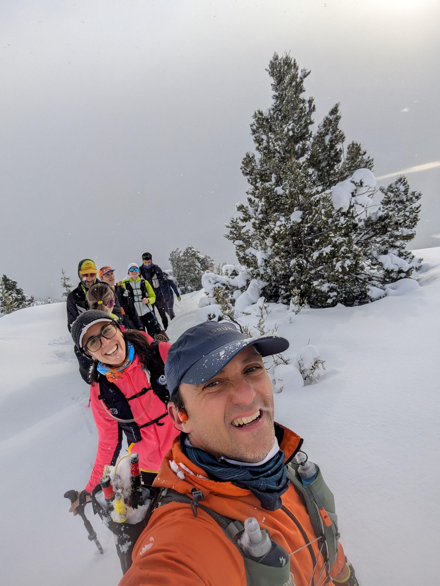
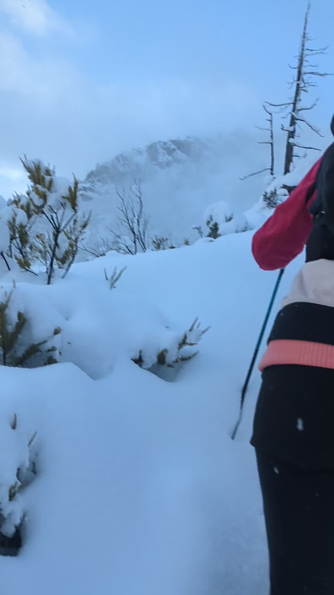

## 📊 Estadísticas Clave
- **Distancia:** 23.64 km
- **Desnivel Positivo:** 637.0 m 🏔️
- **Tiempo en movimiento:** 203:22
- **Tipo de actividad:** Run

## 🗺️ Mapa y Recorrido


## ⏱️ Vueltas (Laps)
| Lap | Distancia | Tiempo | Ritmo | FC Med |
| :--- | :--- | :--- | :--- | :--- |
| 1 | 1.0 km | 7:04 | 7:04 | 124.0 |
| 2 | 1.0 km | 6:13 | 6:13 | 139.3 |
| 3 | 1.0 km | 9:13 | 9:13 | 140.1 |
| 4 | 1.0 km | 6:46 | 6:46 | 0.0 |
| 5 | 1.0 km | 6:35 | 6:35 | 0.0 |
| 6 | 1.0 km | 6:45 | 6:45 | 0.0 |
| 7 | 1.0 km | 26:59 | 26:59 | 144.1 |
| 8 | 1.0 km | 24:28 | 24:28 | 158.6 |
| 9 | 1.0 km | 12:33 | 12:33 | 150.4 |
| 10 | 1.0 km | 8:52 | 8:52 | 154.1 |
| 11 | 1.0 km | 7:21 | 7:21 | 155.1 |
| 12 | 1.0 km | 9:23 | 9:23 | 145.1 |
| 13 | 1.0 km | 5:00 | 5:00 | 147.3 |
| 14 | 1.0 km | 5:36 | 5:36 | 157.5 |
| 15 | 1.0 km | 5:02 | 5:02 | 158.6 |
| 16 | 1.0 km | 5:18 | 5:18 | 156.4 |
| 17 | 1.0 km | 6:13 | 6:13 | 161.0 |
| 18 | 1.0 km | 5:38 | 5:38 | 160.5 |
| 19 | 1.0 km | 5:29 | 5:29 | 160.1 |
| 20 | 1.0 km | 7:14 | 7:14 | 165.4 |
| 21 | 1.0 km | 7:47 | 7:47 | 0.0 |
| 22 | 0.58 km | 67:53 | 116:26 | 148.7 |

## 📸 Fotos

---
*Generado automáticamente vía API de Strava.*
