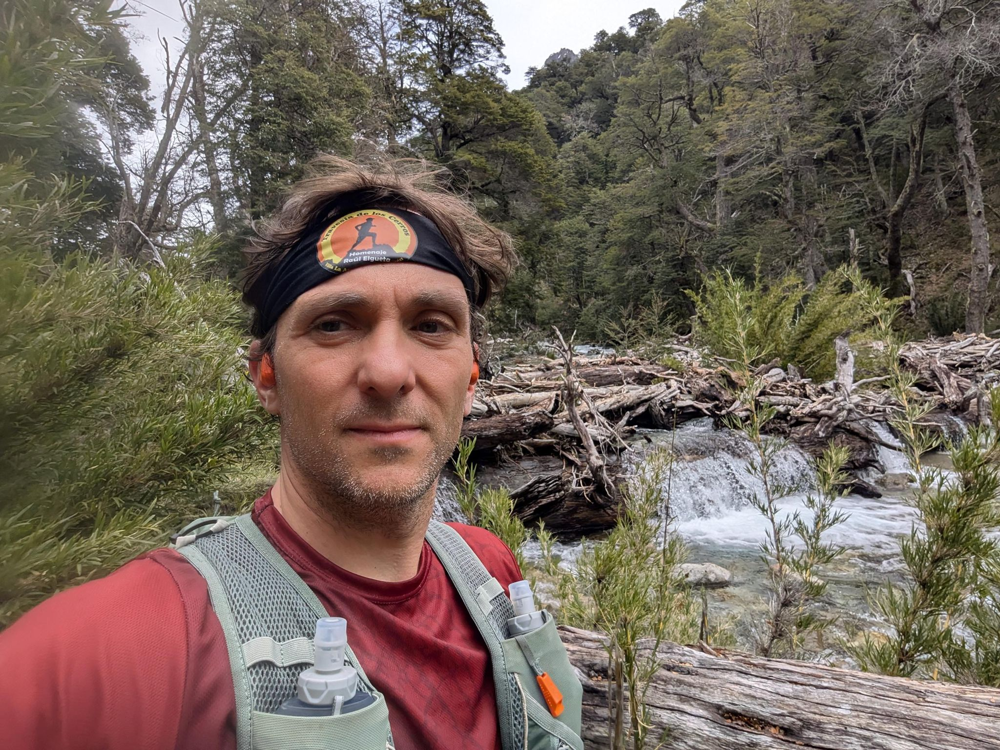

## 📊 Estadísticas Clave
- **Distancia:** 36.41 km
- **Desnivel Positivo:** 703.0 m 🏔️
- **Tiempo en movimiento:** 261:45
- **Tipo de actividad:** Run

## 🗺️ Mapa y Recorrido


## ⏱️ Vueltas (Laps)
| Lap | Distancia | Tiempo | Ritmo | FC Med |
| :--- | :--- | :--- | :--- | :--- |
| 1 | 1.0 km | 6:13 | 6:13 | 121.6 |
| 2 | 1.0 km | 6:33 | 6:33 | 150.2 |
| 3 | 1.0 km | 5:59 | 5:59 | 148.0 |
| 4 | 1.0 km | 6:29 | 6:29 | 140.0 |
| 5 | 1.0 km | 12:29 | 12:29 | 125.3 |
| 6 | 1.0 km | 7:13 | 7:13 | 132.3 |
| 7 | 1.0 km | 5:20 | 5:20 | 144.1 |
| 8 | 1.0 km | 5:48 | 5:48 | 149.7 |
| 9 | 1.0 km | 5:34 | 5:34 | 145.8 |
| 10 | 1.0 km | 5:10 | 5:10 | 141.3 |
| 11 | 1.0 km | 5:22 | 5:22 | 145.8 |
| 12 | 1.0 km | 5:36 | 5:36 | 148.1 |
| 13 | 1.0 km | 5:34 | 5:34 | 146.6 |
| 14 | 1.0 km | 5:48 | 5:48 | 146.4 |
| 15 | 1.0 km | 7:18 | 7:18 | 147.9 |
| 16 | 1.0 km | 8:27 | 8:27 | 155.4 |
| 17 | 1.0 km | 9:23 | 9:23 | 155.8 |
| 18 | 1.0 km | 10:10 | 10:10 | 143.9 |
| 19 | 1.0 km | 11:31 | 11:31 | 149.1 |
| 20 | 1.0 km | 13:59 | 13:59 | 126.2 |
| 21 | 1.0 km | 8:18 | 8:18 | 139.6 |
| 22 | 1.0 km | 7:02 | 7:02 | 157.1 |
| 23 | 1.0 km | 6:42 | 6:42 | 159.0 |
| 24 | 1.0 km | 5:34 | 5:34 | 158.8 |
| 25 | 1.0 km | 5:48 | 5:48 | 165.8 |
| 26 | 1.0 km | 6:10 | 6:10 | 148.8 |
| 27 | 1.0 km | 6:23 | 6:23 | 145.0 |
| 28 | 1.0 km | 6:06 | 6:06 | 147.4 |
| 29 | 1.0 km | 6:56 | 6:56 | 149.0 |
| 30 | 1.0 km | 6:23 | 6:23 | 154.3 |
| 31 | 1.0 km | 6:24 | 6:24 | 154.1 |
| 32 | 1.0 km | 6:44 | 6:44 | 151.3 |
| 33 | 1.0 km | 7:05 | 7:05 | 151.0 |
| 34 | 1.0 km | 7:27 | 7:27 | 151.8 |
| 35 | 1.0 km | 7:04 | 7:04 | 152.2 |
| 36 | 1.0 km | 7:51 | 7:51 | 144.3 |
| 37 | 0.55 km | 9:54 | 17:58 | 149.9 |

## 📸 Fotos

---
*Generado automáticamente vía API de Strava.*
