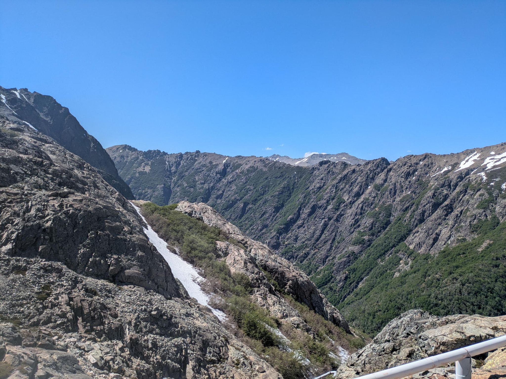
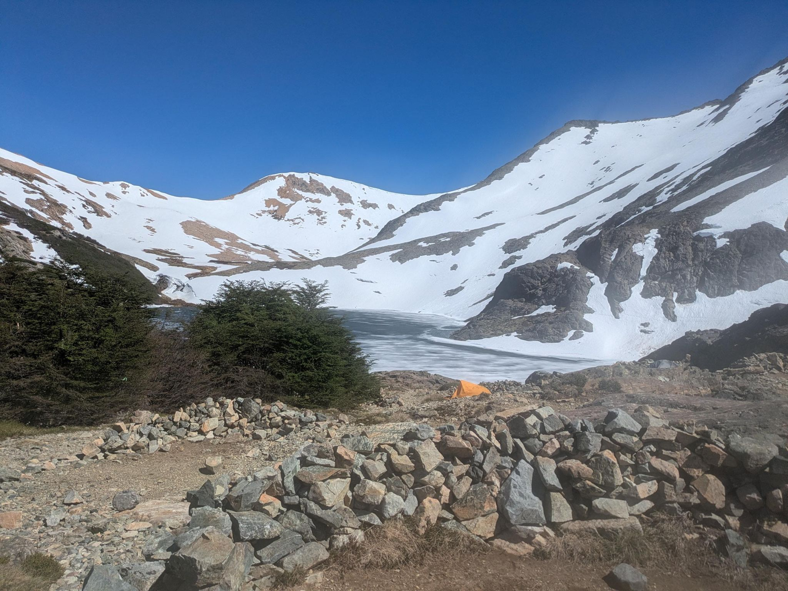
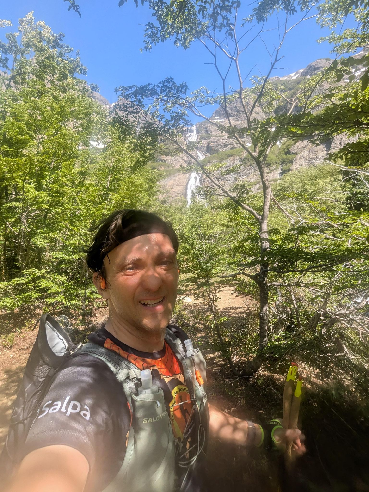
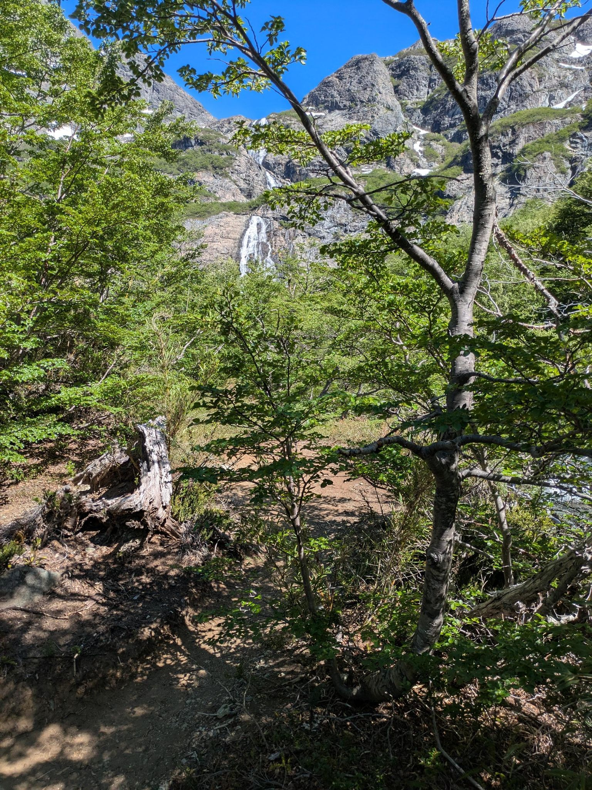

## 📊 Estadísticas Clave
- **Distancia:** 18.96 km
- **Desnivel Positivo:** 938.0 m 🏔️
- **Tiempo en movimiento:** 203:17
- **Tipo de actividad:** Run

## 🗺️ Mapa y Recorrido


## ⏱️ Vueltas (Laps)
| Lap | Distancia | Tiempo | Ritmo | FC Med |
| :--- | :--- | :--- | :--- | :--- |
| 1 | 1.0 km | 7:46 | 7:46 | 164.4 |
| 2 | 1.0 km | 9:53 | 9:53 | 161.3 |
| 3 | 1.0 km | 10:43 | 10:43 | 161.5 |
| 4 | 1.0 km | 7:55 | 7:55 | 163.1 |
| 5 | 1.0 km | 9:22 | 9:22 | 157.4 |
| 6 | 1.0 km | 8:09 | 8:09 | 140.7 |
| 7 | 1.0 km | 14:21 | 14:21 | 157.3 |
| 8 | 1.0 km | 19:57 | 19:57 | 163.7 |
| 9 | 1.0 km | 22:44 | 22:44 | 156.3 |
| 10 | 1.0 km | 18:11 | 18:11 | 135.0 |
| 11 | 1.0 km | 11:29 | 11:29 | 130.3 |
| 12 | 1.0 km | 7:56 | 7:56 | 134.3 |
| 13 | 1.0 km | 7:48 | 7:48 | 137.5 |
| 14 | 1.0 km | 7:04 | 7:04 | 146.9 |
| 15 | 1.0 km | 9:03 | 9:03 | 151.0 |
| 16 | 1.0 km | 8:06 | 8:06 | 151.2 |
| 17 | 1.0 km | 9:09 | 9:09 | 155.0 |
| 18 | 1.0 km | 7:02 | 7:02 | 156.4 |
| 19 | 1.0 km | 5:11 | 5:11 | 157.8 |
| 20 | 0.29 km | 11:36 | 40:08 | 154.7 |

## 📸 Fotos

---
*Generado automáticamente vía API de Strava.*
